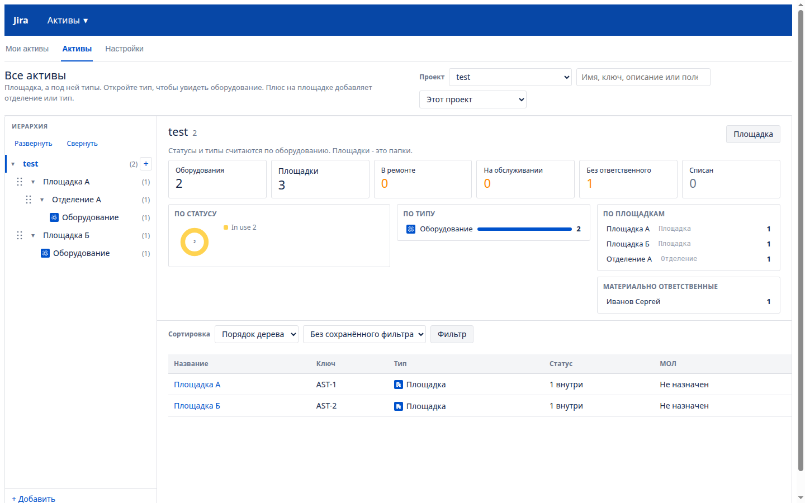
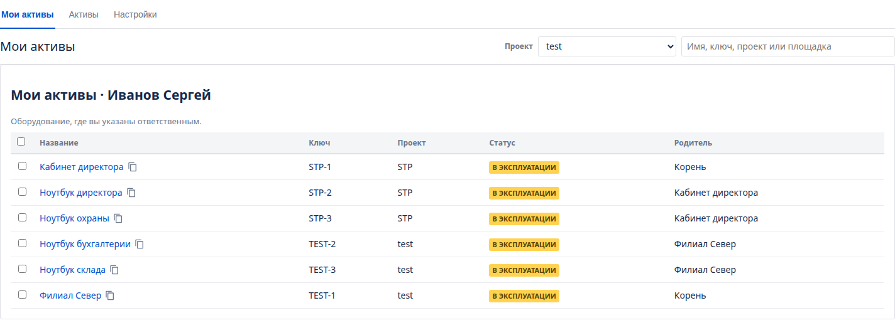
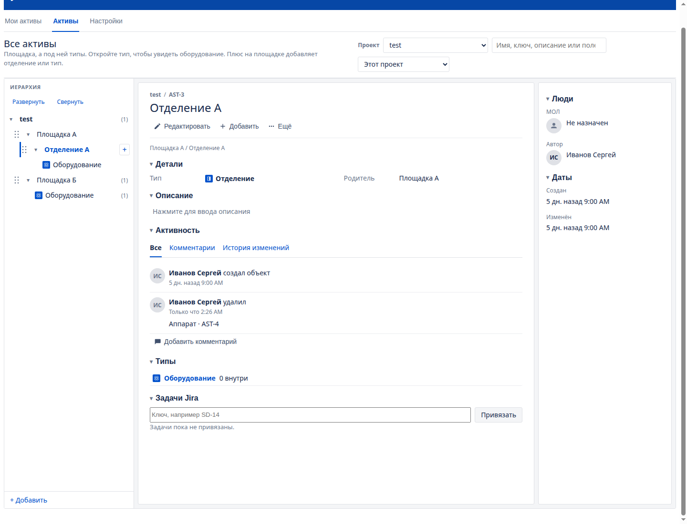
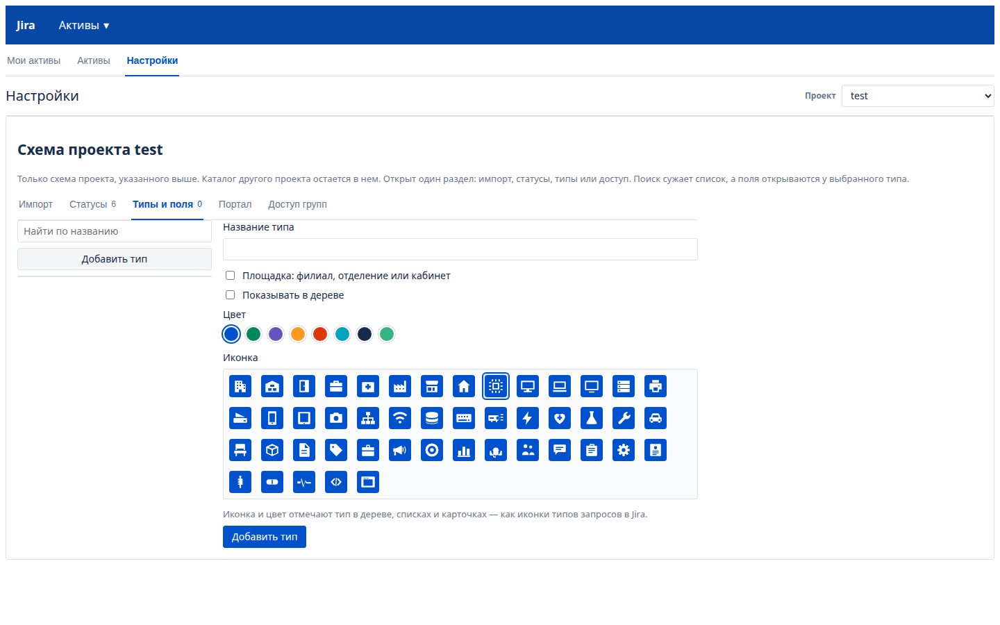

# Niout AssetHub for JSM версия 1.3.184

Дерево активов для Jira Service Management **4.21.1** (платформа Jira **8.21.1**, байткод **Java 8**). Экран встроен в страницу Jira. Готовых макетов нет: в списке только ваши проекты, типы объектов и активы вы создаёте сами. Чужой проект в дереве не появляется.

## Скриншоты 









Данные лежат в базе Jira через Active Objects. Отдельная база не нужна. Пользователи берутся из каталога Jira, в том числе из Active Directory.

## Как это закрывает задачу

1. **Проекты не пересекаются.** Дерево, типы, поля, статусы и доступ групп принадлежат проекту. Новый объект получает ключ своего проекта: в STP это STP-1, в другом проекте своя нумерация, поэтому ключи не совпадают. Уже выданные ключи AST- не переписываются. Экран активов виден тем, кто может просматривать проект, и тем, кому в настройках этого проекта выдан доступ: группе или пользователю. Администратор Jira видит все. Клиент портала, у которого есть только создание заявок, экран активов не видит: на портале ему доступно поле «Актив проекта». В своём профиле он видит оборудование, которое за ним числится, если проект это включил: как за МОЛ, выданное ему, указанное в поле «Пользователь» и открытое ему через общий доступ. Общий доступ помечен отдельно. Правка дерева — это отдельное право, не «Редактирование задач». Актив другого проекта для запроса возвращается как «не найден».
2. **Иерархия.** Корень — проект. Под площадкой видны только типы, которые туда добавили, и типы, у которых уже есть оборудование. Новый филиал не получает все типы проекта: в Усть-Лабинске может не быть неттопов. Пустой тип убирается с этой площадки. Плюс на типе добавляет оборудование или тип внутрь, так же как плюс на площадке добавляет отделение или тип. Тип внутри типа заменяет отделение: «ОЛД» → «Рентген» → аппарат «Ge Brivo». Вложенный тип виден только там, где его добавили или где уже стоит такое оборудование. Тип внутри типа дальше не вкладывается. На конкретной площадке тип перетаскивается: верх строки ставит его выше, низ — ниже, середина другого типа вкладывает в него, перенос на строку площадки выносит обратно. Так может администратор этого проекта и тот, у кого прав больше. На строке типа остаётся только плюс. Это положение только у этой площадки. Клик по филиалу открывает его как заявку Jira без статуса: панель действий, детали, описание по клику, люди и даты. Типы и отделения внутри идут строками связанных заявок, без плашек статуса. Цифры и статусы стоят над списком **Все активы**. Клик по типу открывает всё оборудование этого типа. Плюс на площадке добавляет отделение или тип. Плюс на типе добавляет оборудование или тип внутрь. В карточке оборудования тип показан своим названием, без родительского типа. Сменить его можно в режиме правки: аппарат переходит в другой тип, поля нового типа подставляются на место старых. В списке площадок, оборудования и типов можно отметить несколько строк: сменить статус, ответственного, перенести или удалить. На карточке площадки видна её история: кто добавил объект, перенёс его сюда или отсюда, и кто удалил. Удаление остаётся на площадке после того, как карточка объекта уже стёрта. С карточки оборудования и из списка печатается наклейка. Пока в проекте не сохранён свой шаблон, на ней имя, тип, место, ключ и QR. Сканирование открывает эту карточку в Jira. В **Настройки → Карточка** наклейку собирают свободно: блоки перетаскивают по листу и по сетке, меняют размер, шрифт, цвет и начертание. Размер листа задаётся в миллиметрах. Можно добавить свою подпись, логотип, код актива и блок пользовательского QR. У каждого оборудования свой QR: в меню «Ещё» его либо загружают, либо удаляют, на экране карточки он не показывается, а на наклейке встаёт в блок «Пользовательский QR». Ширину дерева и правой панели меняют, потянув за край. Строка места на карточке называется так, как назван тип площадки над объектом. У типа площадки можно задать свою подпись: филиал, отделение, кабинет или другое слово. Пустая подпись оставляет название типа.
3. **Статусы.** У каждого проекта свой список. Сразу есть шесть: на складе, в эксплуатации, в ремонте, в резерве, на обслуживании, списан. В настройках проекта их можно переименовать, добавить и удалить, если статус не используется. Цвет плашки выбирается из палитры: к выполнению, в работе, готово, синий, оранжевый, красный, фиолетовый, бирюзовый, серый, розовый, салатовый, коричневый. Галочка **В сводке** выводит статус цифрой над списком всех активов. Так в сводке появляются свои статусы, например ТО, поверка и КТС. Срок задаётся на карточке оборудования, когда у его типа включено обслуживание: дата последнего проведения и как часто его повторять. В этот день объект переходит в выбранный статус, а ответственному уходит письмо. Кнопка **Проведено** начинает следующий интервал. У типов без этой галочки блока на карточке нет.
4. **МОЛ из каталога.** В карточке выбирается пользователь Jira. Имя, почта, телефон, отдел, должность и каталог подтягиваются из профиля и атрибутов пользователя (телефон, отдел, должность — как их отдаёт AD). Пункт **Мои активы** показывает оборудование, где текущий пользователь указан ответственным: статус, проект и место в дереве. Строка поиска на этом экране сужает список по имени, ключу, проекту и площадке. В колонках списка рядом с МОЛ есть «Кому выдано»: заголовок сортирует. Готовый отчёт и свой отчёт группируют оборудование по этому человеку. Кнопка **Колонки** на этом экране задаёт личный набор: порядок, скрытые поля и свои поля типов. Набор пишется в учётную запись Jira и виден только этому человеку, в том числе в другом браузере. Колонки проекта при этом не меняются.
5. **Иконки типов.** У каждого типа — цвет и иконка в стиле Jira: цветная плашка с белым знаком, как у типов запросов на портале. Иконок около трёхсот, они разложены по разделам: места, ИТ, медицина, эксплуатация, маркетинг, клиентский сервис и офис. Поле поиска над сеткой находит иконку по названию. Знаки взяты из Material Design Icons (Apache 2.0). Иконка выбирается при создании типа и меняется в окне **Типы** или в настройках; она видна в дереве, в списках, в карточке и в сводке. Новые типы и правки схемы появляются на экране сразу, без перезагрузки страницы.
6. **Свои поля у типа.** Поля задаются у типа площадки и у типа оборудования: при создании площадки, в окне **Типы** и в настройках. У филиала можно держать адрес и ответственного, у ноутбука — модель, RAM и ROM, у аппарата УЗИ — модель, серийный номер и производителя. Подтип тоже открывается в **Типы и поля** и хранит свои поля: у «МФУ» серийный номер, у «Принтеров» модель. Поля родительского типа подтип показывает сам, своё поле с тем же ключом заменяет родительское. В списке он стоит под своим типом. Поля бывают текстом, многострочным текстом, числом, датой, пользователем, выпадающим списком, флажками, переключателями, метками, ссылкой и версией. Дата подходит для ввода в эксплуатацию: на карточке она показывается как ДД.ММ.ГГГГ, в файл уходит и из файла читается и так, и как ГГГГ-ММ-ДД. Обязательное поле пустым не сохраняется. В настройках открыт один раздел: статусы, типы, карточка, портал, импорт или доступ. Поиск сужает список. Поля видны только у типа, который выбран слева. Стрелки ↑ и ↓ у поля меняют его место: в этом порядке поля идут на карточке, в форме и в заявке. Кнопка **Колонки** открывает над таблицей редактор, как в очередях JSM: колонки стоят плашками, их перетаскивают мышью или стрелками клавиатуры, × убирает колонку, а **Ещё** открывает список полей с поиском. Поле с одним названием у разных типов — одна колонка. **Сохранить** применяет порядок, **По умолчанию** возвращает исходный набор. Раздел **Импорт** скачивает оборудование книгой Excel и загружает её обратно. Рядом с МОЛ в файле стоит колонка «Кому выдано»: при загрузке она назначает человека, пустая ячейка снимает его, а книга без этой колонки человека не трогает. У каждого типа оборудования свой лист, и на листе только поля этого типа, поэтому одинаковые названия полей разных типов не смешиваются. Пустой ключ создаёт объект, заполненный ключ обновляет его. Прежняя книга с одним листом и CSV тоже принимаются. В файле может быть до 20000 строк. Экран отправляет книгу частями по 400 строк, повтор той же части с тем же ключом не создаёт объекты второй раз. Каждая строка пишется отдельно: проект читается один раз, а каталог спрашивается один раз на новое имя и не держит базу, пока идёт поиск. Ошибка одной строки попадает в список и не отменяет остальные.
7. **Сводка.** На экране **Все активы**, над списком корня проекта, стоят цифры: сколько единиц, площадок, затем статусы с галочкой **В сводке** (сразу это ремонт, обслуживание и списание) и сколько без ответственного. Рядом кольцо статусов, типы, площадки с наибольшим числом объектов и ответственные. Клик по цифре или строке отбирает этот же список, клик по площадке открывает её. Отдельного пункта меню нет: старая ссылка `view=dashboard` открывает **Все активы**. Статусы и типы считаются только по оборудованию. Список **Мои активы** каждый раз читается заново, когда раздел открывают, и обновляется после создания, правки и удаления.
8. **Заявки.** На портале поле **Актив проекта** идёт по площадке, затем по типу и подтипу, затем к самому оборудованию. В выпадающем списке строка выглядит как «Оргтехника / МФУ / имя». На площадке или отделении можно остановиться, не выбирая аппарат: тип и подтип в поле — это шаги, в заявку пишется сам актив. В настройках проекта, вкладка **Портал**, правило говорит: если в поле заявки выбран пункт, поле актива открывается на этой площадке. Правило из двух полей важнее одного: площадка А и отделение А открывают отделение, а не всю площадку. Пока поля не выбраны, список активов не показывается. Когда правило совпало, поле на портале клиента становится выпадающим списком активов этой площадки или этого отделения. Service Desk сам рисует это поле обычной строкой, поэтому список подставляется на странице создания заявки. Значение пишет связь заявки с активом того же проекта. На карточке заявки панель **Активы** ищет и привязывает ещё оборудование — тоже только своего проекта. Строка поиска короче панели. Под привязанным активом стоит карточка: имя и те поля типа, у которых включено «Показывать в заявке», и МОЛ, если он указан. Галочка стоит в **Типы и поля** у каждого поля. Снятая галочка оставляет поле на карточке актива. Так видно, например, по какой заявке принтер списан. В **Настройки → Портал**, под правилами поля, схема каждого проекта собирается из узлов. Линия от «Оборудование в заявке» к «Статус оборудования» срабатывает, когда в заявку этого типа добавляют оборудование: при создании и позже, из поля «Актив проекта», с панели заявки или с карточки актива. Если заявка уже стоит в статусе из цепочки, оборудование сразу получает статус цепочки. Цепочка «Оборудование в заявке» → «Статус заявки» → «Статус оборудования» также срабатывает, когда заявка переходит в выбранный статус: уже связанное оборудование получает новый статус. Одна заявка может вести и к статусу при создании, и к другому статусу при смене статуса заявки. Узел без линии ничего не меняет. Площадка статус не меняет. Первое открытие заявки и повтор той же смены статус не трогают. Для случая, когда оборудование убирают из заявки, можно выбрать **Вернуть исходный статус**: при привязке плагин запоминает статус оборудования и при удалении из заявки возвращает именно его. На той же вкладке проект включает показ оборудования в профиле клиента: за ним как за МОЛ, выданное ему и указанное в поле «Пользователь». Каждый такой проект идёт своей группой, а набор полей на карточке задаётся отдельно. Над списком в профиле есть поиск по имени, ключу, роли и полям. В карточке кнопка «Создать заявку» открывает обычный портал этого проекта. Выбранный актив уже стоит в поле «Актив проекта», потому что на портале клиент может выбрать другой объект. Если на форме этого поля нет, оборудование всё равно привязывается к созданной заявке.

## Графики и табель

Модуль обслуживания добавляет вкладку **Графики**: календарь работ и табель. Календарь открывается месяцем, неделей, рабочей неделей и днём. Работа ставится на оборудование или без него, повторяется и переносится на другой день. «Проведено» закрывает выбранный день серии. Табель собирает людей по филиалам, которые добавлены вручную. Графики 5/2, 2/2 и остальные сменные заполняют месяц от выбранного дня. Щелчок, протяжка и меню дня ставят ситуацию, часы, отпуск и больничный. Excel скачивает открытый месяц. Справа от сетки — заметки по строкам.

## Отчёты

Вкладка **Отчёты** считает стандартные срезы и свои. Стандартные: статусы, типы, площадки, ответственные, кому выдано, поступления, стоимость, гарантия, возраст, списания, работы графика и выполненные работы. Выполненные работы считаются по дням, которые график отметил проведёнными. Свой отчёт может взять этот источник и сгруппировать его по виду, месяцу, площадке, типу или исполнителю. Пока модуль графиков выключен, этот отчёт скрыт. Свой отчёт группирует по тем же полям, по полю типа и по тому, кому выдано, и может оставить только объекты, у которых поле содержит значение. Диаграмма — столбчатая, гистограмма, полосы, линейная, с областями, точечная, кольцо, круг, радарная, Ганта и Венна. Щелчок по значению открывает отфильтрованный список активов. Открытый отчёт скачивается кнопкой «Скачать отчёт»: файл Excel с таблицей и диаграммой выбранного вида. Письмо по расписанию по-прежнему прикладывает книгу всех видимых отчётов. Книга готовится отдельно от страницы: запрос возвращает номер задания, страница забирает файл, когда он готов. Списки длиннее тысячи строк листаются по страницам. Книга может уходить письмом по расписанию. Если включён жизненный цикл, над отчётами виден прогноз замены на 12 месяцев.

## Схемы

Вкладка **Схемы** заменяет карту. Холст считает сантиметры: одна единица — 1 см, ось Y смотрит вниз. Колесо приближает к курсору, лист двигается средней кнопкой, пробелом с левой кнопкой или протяжкой правой кнопки. Сетка шагает на 1, 5, 10, 25, 50 или 100 см. Инструменты подписаны словами и иконками: линия, прямоугольник, эллипс, перо, стена, текст, размер, дверь и окно. Пока стена тянется, над курсором видна её длина. Стена — один отрезок, следующая пристаёт к концу или к телу, угол собирается без шва и без лучей. Замкнутый контур толще 0,3 м² становится комнатой, имя и цвет сохраняются, если контур сдвинулся немного. Список сверху переключает схемы проекта, кнопка «Удалить схему» убирает текущую. Имена этажа, слоя, комнаты и текста вводятся в окне плагина. Рядом схема привязывается к площадке. Шаблон собирается из выделенных фигур: правый щелчок и «Сделать шаблон». Готовый шаблон ставится на лист, «Изменить» открывает его части. Шаблон и комната привязываются к активу этого проекта через поиск по имени и ключу. Схема хранится в проекте и открывается снова после сохранения.

Вкладка открывается списком схем: «Открыть» показывает чертёж без инструментов, «Редактировать» включает правку. У фигуры есть заливка, текст внутри и материал. Длина и угол видны и пока тянется линия, и на готовой фигуре. Перо ставит угол щелчком и изгиб протяжкой. Площадка схемы видна на карточке в списке и в карточке самой площадки. «Изменить» у шаблона открывает его на том же холсте.

Схема открывается чертежом на холсте, в размере экрана. Флажок «Размеры» прячет длины и углы. Любой слой, в том числе начальный, удаляется, пока слой не последний: его фигуры переходят на оставшийся. В списке «Активы» строка показывает имя и ключ. Щелчок берёт актив, один щелчок по листу ставит значок оборудования и снимает выбор. Тот же актив второй раз не копируется: следующий щелчок переносит уже стоящий. Крестик у строки убирает его со схемы. Повторный щелчок по шаблону снимает выбор. Несколько фигур собираются в группу, шаблон и актив поворачиваются, «На передний план» и «На задний план» меняют порядок.

## Карточка, файлы и жизненный цикл

Карточка оборудования собрана как заявка: действия, детали, описание, вложения и активность. Комментарий пишется в ленте. Файл открывается предпросмотром на весь экран: картинка, PDF и текст. Общий доступ открывает карточку другим людям, на портале она помечается отдельно. Жизненный цикл хранит закупку, цену, гарантию, амортизацию и списание с согласованием. Остаточная стоимость пересчитывается при сохранении карточки и раз в месяц заданием. Дата замены — день, когда заканчивается срок полезного использования. Списание по-прежнему подтверждает человек. Наклейка печатается из списка и с карточки. Пока свой макет не сохранён, на ней имя, тип, место, ключ и QR.

## Сборка

Нужен JDK 8 и Maven 3.6+. На более новой JDK плагин соберётся, только если байткод останется 1.8: Jira 8.21 класс новее не загрузит.

```bash
export JAVA_HOME=/usr/lib/jvm/java-8-openjdk-amd64
mvn -B package
```

Готовый файл: `target/asset-tree-1.3.184.jar`.

```bash
mvn -B test
```

## Установка

Если Niout AssetHub уже включён, загрузите новый jar поверх: это обновление. Если в списке лежит отключённое приложение, удалите его и загрузите jar заново. Обновление поверх приложения, которое не запустилось, оставляет старую ошибку.

1. **Администрирование → Приложения → Управление приложениями → Загрузить приложение** и выберите jar.
2. Разведите доступ, как в разделе ниже. Пункт **Активы** виден тем, кто может просматривать проект, и группам с правом просмотра. **Настройки** — тем, у кого есть виды «Типы», «Активы» или «Администратор».
3. Пункт **Активы** в верхней навигации открывает меню: **Мои активы**, **Все активы**, **Настройки**. Те же разделы продублированы вкладками над страницей: **Мои активы**, **Активы**, **Настройки**. Вкладка **Настройки** видна тем же людям, что и пункт меню. Сводка — цифры, статусы и типы — стоит в шапке списка **Все активы**. Поиск стоит на этом же экране: строка ищет по имени, ключу, описанию и полям в выбранном проекте или во всех видимых. С площадки и из типа результат тот же, что в корне. Заголовок колонки сортирует список корня, площадки и типа, повторный щелчок меняет направление. Правила можно сохранить как свой фильтр. В боковом меню проекта ссылка открывает активы этого проекта: `/plugins/servlet/asset-tree?project=KEY&view=all`.
4. Для портала: **Администрирование → Задачи → Настраиваемые поля → Добавить**, тип **Актив проекта**. Повесьте поле на нужный тип запроса Service Desk и на экран. Медицине — на тип заявки портала. ИТ может не выводить его на портал и пользоваться только панелью на карточке. Чтобы выбор открывался с нужной площадки, в **Активы → Настройки → Портал** добавьте правило: имя поля на форме, текст пункта и место в дереве.
5. Клиент портала остаётся в роли Service Desk Customers: создание заявок есть, просмотра проекта нет. Тогда каскад на портале работает, а экран активов не открывается.

## Роли

Площадка — это филиал, отделение или кабинет. Тип — вид объекта. Объект — само оборудование. Чужой проект не появляется, кроме роли «Администратор».

В **Активы → Настройки → Доступ групп** группе выдают один или несколько видов:

| Вид | Что можно |
| --- | --- |
| Просмотр | Смотреть дерево, типы, объекты и сводку |
| Площадки | Добавлять, менять и удалять площадки: филиал, отделение, кабинет |
| Типы | Добавлять, менять и удалять типы объектов |
| Объект | Добавлять, менять и удалять объекты, статус, поля и переносить их |
| Активы | Полный доступ к активам своего проекта: площадки, типы, объекты и список доступа этого проекта |
| Администратор | Полный доступ ко всему и во всех проектах. Этот вид может выдать только администратор |
| Только отчёты | Смотреть отчёты. Дерево активов не открывается |
| Только карта | Смотреть план этажа. Дерево активов не открывается |

Просмотр входит в площадки, типы, объект, активы и администратора. Виды «Только отчёты» и «Только карта» просмотр не добавляют. У права можно сузить типы: список ключей типов или имя схемы (именованный набор типов). Схема важнее списка. Поля задаются как `ключ:read` или `ключ:write`. Пустой список означает все типы или все поля. Если ограничение полей задано, поле вне списка скрыто. Несколько прав складываются, более широкое побеждает. «Активы» включает просмотр, площадки, типы и объекты. «Администратор» включает всё это во всех проектах. Просмотр проекта в Jira эти ограничения не сужает.

| Кто в Jira | Какой это вид |
| --- | --- |
| Администраторы Jira | Администратор: все проекты |
| Руководитель проекта, роль **Administrators** | Активы этого проекта |
| Право проекта **Изменение активов** | Активы этого проекта |
| Группа только с просмотром проекта, без отдельного вида | Просмотр |
| Пользователи портала, роль **Service Desk Customers** | Только поле «Актив проекта» на портале |

Право **Изменение активов** лежит в схеме прав: **Администрирование → Задачи → Схемы прав**. Выдайте его роли проекта, а не всем сотрудникам. Глобальное право **Управление активами** даёт вид «Активы» в тех проектах, которые человек и так открывает.

Язык экрана совпадает с языком пользователя Jira: русский или английский.

## Как вести дерево

1. Плюс у проекта добавляет филиал. Назовите тип площадки и сам филиал, поля — адрес и ответственный.
2. Плюс на филиале: **Тип оборудования** — Ноутбук, Принтер, Монитор или УЗИ, у каждого свои поля. Тип сразу появляется под филиалом. **Площадка внутри** — отделение или кабинет; типы переезжают под него.
3. Клик по типу показывает оборудование. Плюс на типе добавляет объект: планшет Samsung или УЗИ GE, статус «В эксплуатации», МОЛ и кому выдано. У строки оборудования есть копирование. Отмеченные строки копируются вместе. Панель статуса, МОЛ, печати, копирования, переноса и удаления остаётся внизу экрана, пока выделение не снято: к ней не нужно возвращаться прокруткой.
4. Карточка оборудования собрана как заявка Jira: панель действий, детали, описание по клику, вложения и активность. Статус — цветная плашка, как в заявке, и меняется с неё. МОЛ меняется в блоке «Люди». Выпадающий список, флажки, переключатели, метки, ссылка и версия тоже меняются прямо в карточке: клик по значению, выбор сохраняется сразу, метка, ссылка и версия — по Enter или когда поле теряет фокус. Кнопка **Копировать** создаёт такой же объект рядом: тот же тип, место, статус, описание, ответственный и поля, новый ключ и имя с пометкой «копия». Файлы и заявки остаются у исходного объекта. Комментарий выглядит как в активности заявки. Файл, в том числе PDF, кладётся в зону вложений или выбирается через «обзор». В активности видны комментарии и история: кто создал объект, сменил статус, МОЛ, поле или файл. У площадки слева постоянная метка из точек. Тяните за неё: верхняя треть строки — перед узлом, нижняя — после, середина — внутрь.
5. В блоке задач укажите ключ заявки того же проекта, например `SD-14`.

Удаление узла с потомками спрашивает подтверждение и снимает ветку, поля и связи.

## REST

Базовый путь: `/rest/asset-tree/1.0`. Нужна сессия Jira и заголовок `X-Atlassian-Token: no-check`. Повтор импорта не создаёт строки второй раз, если передан `idempotencyKey` в теле или заголовок `X-Idempotency-Key`. Пустое поле при `skipBlank` (так и есть, если флаг не передан) не затирает уже записанное значение.

| Метод | Путь | Назначение |
| --- | --- | --- |
| GET | `/meta` | Проекты, права, личные колонки, строки интерфейса |
| PUT | `/me/columns` | Личные колонки и сортировка «Мои активы» |
| GET | `/assets?projectKey=IT` | Дерево, типы и статусы. `q` — до 30 совпадений |
| POST | `/assets` | Создать узел |
| GET | `/assets/{id}` | Карточка |
| PUT | `/assets/{id}` | Изменить карточку |
| POST | `/assets/{id}/copy` | Копия объекта |
| POST | `/assets/{id}/move` | Перенос |
| DELETE | `/assets/{id}?cascade=true` | Удалить узел или ветку |
| GET, POST | `/assets/{id}/comments` | Комментарии |
| GET, POST, DELETE | `/assets/{id}/files` | Файлы карточки |
| GET, POST, DELETE | `/assets/{id}/shares` | Общий доступ |
| GET, POST, DELETE | `/assets/{id}/peers` | Связанные объекты без типа: пара хранится один раз |
| POST | `/assets/{id}/links` | Типизированная связь: `type` (`part`, `depends`, `installed` или свой ключ), `assetId`, `attributes` |
| PUT | `/assets/{id}/links/{linkId}` | Сменить тип или атрибуты. Пустое значение атрибута не стирает записанное, пока `skipBlank` не равен `false` |
| DELETE | `/assets/{id}/links/{linkId}` | Удалить связь |
| GET | `/projects/{key}/inventory` | Инвентаризация: кто и когда отметил объект |
| POST | `/assets/{id}/inventory` | Отметка инвентаризации |
| POST | `/types` | Свой тип |
| PUT | `/types/{typeKey}` | Частичное обновление типа |
| DELETE | `/types/{typeKey}` | Удалить неиспользуемый тип |
| POST | `/types/{typeKey}/fields` | Поле типа |
| DELETE | `/types/{typeKey}/fields/{fieldKey}` | Удалить поле |
| GET, POST | `/projects/{key}/statuses` | Статусы проекта |
| PUT, DELETE | `/projects/{key}/statuses/{statusKey}` | Изменить или удалить статус |
| GET | `/projects/{key}/schedule` | График работ, включая проведённые дни |
| POST | `/projects/{key}/schedule` | Поставить работу без объекта |
| PUT, DELETE | `/assets/{id}/plans/{planId}` | Изменить или удалить работу. `done: true` отмечает проведение и оставляет день в календаре |
| GET, PUT | `/projects/{key}/staff` | Табель месяца |
| POST | `/projects/{key}/staff/leave` | Отпуск или больничный на диапазон дней |
| DELETE | `/projects/{key}/staff/{dutyId}` | Снять отметку табеля |
| GET | `/projects/{key}/floors` | Этажи карты. Достаточно вида «Только карта» |
| POST | `/projects/{key}/floors` | Новый этаж |
| PUT, DELETE | `/projects/{key}/floors/{floorId}` | Сохранить план, комнаты и метки или удалить этаж |
| GET | `/projects/{key}/report` | Сводка проекта |
| GET | `/projects/{key}/reports` | Каталог отчётов |
| POST | `/projects/{key}/reports` | Свой отчёт |
| GET | `/projects/{key}/reports/{reportKey}` | Карточка отчёта. `lineFrom` и `lines=all` листают строки |
| PUT, DELETE | `/projects/{key}/reports/{reportKey}` | Изменить или удалить свой отчёт |
| GET | `/projects/{key}/reports/{reportKey}/book.xlsx` | Excel открытого отчёта |
| GET | `/projects/{key}/reports.xlsx` | Книга отчётов сразу, для автоматизации |
| POST | `/projects/{key}/reports/mail` | Поставить письмо с книгой |
| GET | `/assets/{id}/lifecycle` | Закупка, амортизация, дата замены |
| PUT | `/assets/{id}/lifecycle` | Сохранить жизненный цикл и пересчитать книгу |
| POST | `/assets/{id}/lifecycle/writeoff` | Запросить списание |
| POST | `/assets/{id}/lifecycle/decision` | Согласовать списание |
| GET | `/projects/{key}/lifecycle/forecast?within=12` | Оборудование к замене, `within` от 1 до 120 месяцев |
| GET | `/projects/{key}/equipment.xlsx` | Книга оборудования сразу |
| POST | `/projects/{key}/equipment` | Импорт Excel или CSV. `chunked: true` пишет 400 строк и возвращает `uploadId`, `nextOffset`, `done` |
| POST | `/projects/{key}/import` | JSON-импорт CMDB: `items` с `key`, `externalId`, `name`, `type`, `status`, `place`, `custodian`, `issued`, `description`, `fields` |
| POST | `/projects/{key}/discovery` | Тот же приёмник для Discovery |
| PUT | `/projects/{key}/objects/{objectKey}?skipBlank=true` | Частичное обновление по ключу. Пустые поля не затирают записанные |
| POST | `/projects/{key}/exports` | `{"kind":"equipment"}` или `reports`. Ответ — задание |
| GET | `/projects/{key}/exports/{jobId}` | Состояние: `queued`, `running`, `done`, `failed` |
| GET | `/projects/{key}/exports/{jobId}/file` | Готовый файл |
| GET, POST | `/projects/{key}/schemas` | Схемы: именованные наборы типов |
| DELETE | `/projects/{key}/schemas/{id}` | Удалить схему |
| GET, POST | `/projects/{key}/webhooks` | Исходящий вызов: `url`, `secret`, `events`, `enabled` |
| POST | `/projects/{key}/webhooks/test` | Пробный вызов на адрес: в ответе `status` и `ok` |
| DELETE | `/projects/{key}/webhooks/{id}` | Удалить вызов |
| GET | `/projects/{key}/grants` | Права. `caps` включает `reports` и `map`. `typeScope`, `fieldScope`, `schemaName` сужают типы и поля |
| POST | `/projects/{key}/grants` | Выдать право группе или `userKey` |
| DELETE | `/projects/{key}/grants?group=` | Снять право |
| GET, PUT | `/projects/{key}/card` | Макет наклейки: размер листа, блоки, QR |
| GET, POST | `/projects/{key}/flows` | Правила процессов |
| DELETE | `/projects/{key}/flows/{ruleId}` | Удалить правило |
| GET, PUT | `/projects/{key}/flow-graph` | Схема процесса: узлы заявки, статуса заявки и статуса оборудования |
| PUT | `/projects/{key}/view` | Вид проекта. В `setup` записываются только присланные ключи |
| GET | `/projects/{key}/picker` | Дерево для портала |
| GET | `/users?q=` | Поиск пользователя |
| GET | `/issues/{id}/assets` | Активы заявки |
| POST | `/assets/{id}/issues` | Связать заявку |

### Этажи

`GET /projects/{key}/floors` отдаёт этажи проекта. Вида «Только карта» достаточно, чтобы читать план. `POST` создаёт этаж с именем и уровнем. `PUT /projects/{key}/floors/{floorId}` сохраняет лист, комнаты и метки оборудования. `DELETE` удаляет этаж. Лист измеряется в сантиметрах, предел 400 на 300 метров.

### Графики и табель

`GET /projects/{key}/schedule` возвращает работы календаря. Проведённый день остаётся в этом списке и на экране выглядит выполненным. `POST /projects/{key}/schedule` ставит работу без объекта, `POST /assets/{id}/plans` — работу на оборудовании. `PUT /assets/{id}/plans/{planId}` с `done: true` отмечает проведение. `GET` и `PUT /projects/{key}/staff` читают и записывают табель. `POST /projects/{key}/staff/leave` ставит отпуск или больничный, `DELETE /projects/{key}/staff/{dutyId}` снимает отметку.

### Отчёты

`GET /projects/{key}/report` — сводка. `GET /projects/{key}/reports` — каталог, `POST` создаёт свой отчёт, `GET /projects/{key}/reports/{reportKey}` открывает его. `lineFrom` и `lines=all` листают строки. `PUT` и `DELETE` меняют или удаляют свой отчёт. `GET /projects/{key}/reports.xlsx` собирает книгу сразу, `POST /projects/{key}/reports/mail` ставит письмо. Длинная книга также готовится через `POST /projects/{key}/exports`.

### Жизненный цикл

`GET /assets/{id}/lifecycle` читает закупку, амортизацию и дату замены. `PUT` сохраняет их и пересчитывает книгу. `POST /assets/{id}/lifecycle/writeoff` запрашивает списание, `POST /assets/{id}/lifecycle/decision` его согласовывает. `GET /projects/{key}/lifecycle/forecast?within=12` перечисляет оборудование к замене. `within` от 1 до 120 месяцев, просроченное входит в ответ.

### Наклейки

`GET /projects/{key}/card` отдаёт макет наклейки, `PUT` сохраняет размер листа и блоки. Пока свой макет не сохранён, печать берёт имя, тип, место, ключ и QR.

### Процессы

`GET /projects/{key}/issue-types` и `GET /projects/{key}/issue-statuses` отдают типы и статусы заявок Jira. `GET /projects/{key}/flows` читает правила, `POST` добавляет правило, `DELETE /projects/{key}/flows/{ruleId}` удаляет его. `GET` и `PUT /projects/{key}/flow-graph` читают и сохраняют схему: линия от типа заявки к статусу оборудования срабатывает при добавлении актива, линия через статус заявки — при переходе заявки в этот статус.

### Инвентаризация

`GET /projects/{key}/inventory` перечисляет отметки. `POST /assets/{id}/inventory` записывает, что объект проверен. Отдельного пункта меню для этого нет.

### Связи

`GET`, `POST` и `DELETE /assets/{id}/peers` ведут симметричную связь двух объектов без типа. `POST /assets/{id}/links` создаёт направленную связь с типом, обратной подписью и атрибутами: `part` — «входит в» / «включает», `depends` — «зависит от» / «нужен для», `installed` — «установлено на» / «несёт». Свой тип — короткий латинский ключ. `PUT /assets/{id}/links/{linkId}` меняет тип, обратную подпись и атрибуты, не стирая пропущенные. `DELETE` удаляет связь с любой стороны. На карточке связи приходят вместе с `GET /assets/{id}`: поле `direction` говорит, своя это сторона или обратная, поле `inbound` — обратная подпись. Строка показывает тип, имя и ключ. Поле и обратная подпись открываются отдельно.

События исходящего вызова: `asset.created`, `asset.updated`, `asset.deleted`, `import.completed`, `lifecycle.forecast`. Заголовки `X-Asset-Tree-Event` и `X-Asset-Tree-Token`. Пустой список событий означает все. Сбой адреса не отменяет сохранение актива. Массовый импорт шлёт одно событие `import.completed`, а не событие на каждую строку.

### Jira Automation

Создание, изменение и удаление оборудования пишут комментарий в связанную заявку. В запросе портала он внутренний. Правило ставится в самой Jira, как для любой заявки, поэтому экран импорта отдельную инструкцию не показывает. Массовый импорт комментарий на каждую строку не пишет.

### TNI

Модуль **TNI** включается в настройках проекта. На странице создания заявки портала браузер сам записывает устройство: систему, браузер, экран, число ядер, память, видео и локальный адрес, если страница его видит. Когда заявка создана, плагин заводит или обновляет актив выбранного типа и ставит автора заявки ответственным. Площадка берётся из поля заявки, правила портала или совпавшего имени филиала и кабинета. Если таких полей нет, актив встаёт в корень проекта. Сведения об устройстве прикладываются заголовком к запросу, которым портал создаёт заявку, даже если отдельный вызов REST клиенту портала недоступен. В карточку добавляется адрес клиента. Шлюз контейнера, например 172.17.0.1, не записывается: если прокси передал адрес в заголовке, берётся он. Имя из внутренней DNS пишется, когда оно есть.

В настройке модуля для компьютера, ноутбука, телефона и планшета выбирается тип оборудования. Вид без типа не заводится. Срок хранения задаётся в днях. По его окончании плагин проверяет адрес столько раз, сколько указано, распределяя попытки по окну проверки: 3 попытки за 3 дня — одна в день. Ответ начинает срок заново. Если адрес так и молчит, актив переносится в статус «Корзина» или удаляется, а ответственному уходит письмо. Адрес, который браузер не показал, не удаляется: проверить его нечем.

## Предпросмотр без Jira

Рядом лежит сервер с тем же экраном и тем же REST. Это не плагин и не список ваших проектов: без Jira список пуст. В установленном плагине в списке те проекты, которые пользователь может открыть.

```bash
python3 preview/server.py
```

- [Экран активов](http://127.0.0.1:47121)
- [Панель на заявке](http://127.0.0.1:47121/issue)
- [Поле портала](http://127.0.0.1:47121/portal)

Язык берётся из `Accept-Language`: с `en` — английский, иначе русский.

## Совместимость

Собрано против API Jira 8.21.1 и Active Objects 3.5.1. Плагин не зависит от API Service Desk, поэтому встаёт и на Jira Software/Core 8.21.1 той же сборки. Для Data Center в манифесте указан статус `compatible`.
